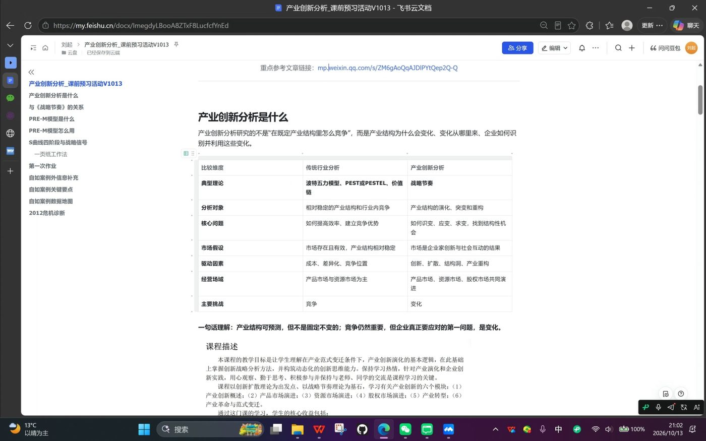
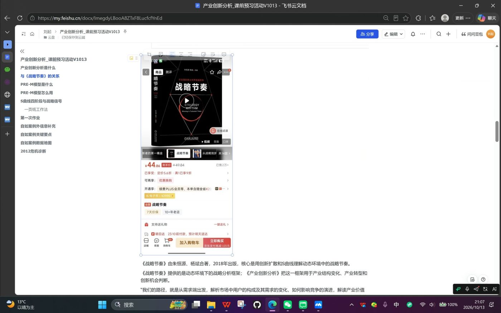
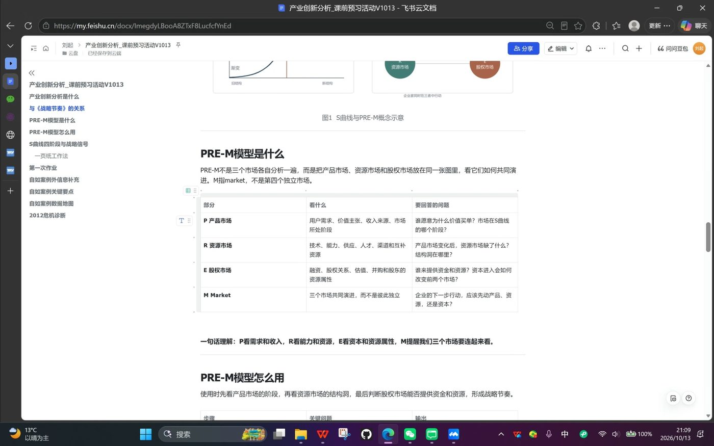
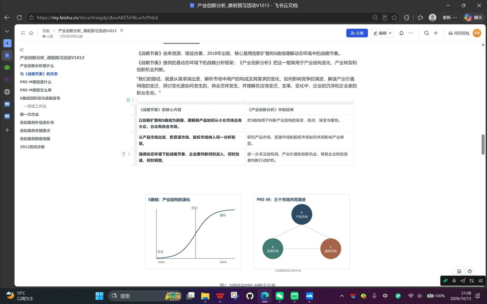
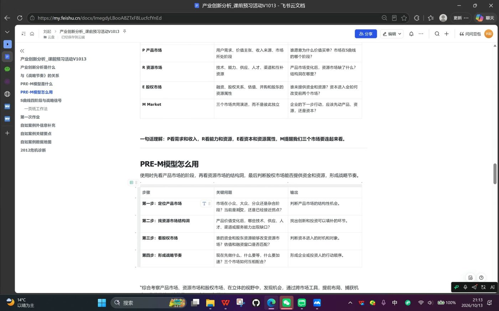

# 25P5《产业创新分析》课前读书预习会 · 详细预习纪要

> 时间：2026 年 10 月 13 日（周二）21:00 至 22:01，腾讯会议（会议号 995 809 008，卓信成预定，全程录制 61 分钟）  
> 主讲：课代表 刘起　主持与收尾：卓信成　深度互动：王鑫　参与讨论：左佑、商黑旦  
> 底层素材：《产业创新分析》课程资料-终版（2026 年 9 月）、案例 1《自如友家起步与起飞》、课前案例分析问题页  
> 说明：本纪要为**预习纪要**，以腾讯会议录制转写逐字稿（110 段，说话人已核）为骨干，辅以会议 AI 图文总结与时间轴，并用三份课程资料 PDF 全文核对补全。刘起开场即强调：**全部内容只基于他对课程材料的个人理解，课堂上老师讲解与讨论可能与此不同**，以老师为准。

---

## 零、一页速览

1. **这门课分析什么**：不是在既定产业结构里比谁效率高，而是研究**产业结构本身怎么变化**，从变化中识别结构性机会。分析是决策的前置条件，这门课就是把"分析"做透。
2. **用什么分析**：核心方法论来自朱恒源《战略节奏》。PRE-M 模型把**产品市场、资源市场、股权市场**放在一张图里看协同演进；时间维度（何时进入、加速、调整）是它区别于静态分析的关键。
3. **作业是什么**：一页 A4 **手写**纸质版，**上课前**交给助教，**迟到和课后提交都不收**。案例 1 自如友家两问：你怎么看自如的商业前景？如果你是熊林，现在怎么办？**10 月 17 日（第一次课）下午上课前交**。
4. **答题时间点**：王鑫现场确认过——**按案例时间点 2013 年 4 月作答，不是 2026 年**。不许开上帝视角马后炮。
5. **案例核心张力**：大三月 104% 达成靠的是**短期激励**（提成翻倍、续约降价、销控），**没有改变定价模式与业务结构**。刘起给出的最佳答题点：**2013 年 9 到 12 月会不会再出现这个问题？**
6. **下一场预告**：10 月 14 日（周二晚）邵忠及两位嘉宾的第二门课课前读书会；课中段班委还将组织 2-3 人线上领读，笔记沉淀到飞书库。

---

## 一、课程定位：产业创新分析到底分析什么

### 1.1 从名字拆起：产业创新 + 分析

刘起开场把课程名拆成两半：

- **产业创新**：项目（清华产业创新 MBA）的核心课程标签；
- **分析**：与之前很多"管理"类课程不同，**分析后面没有跟"决策"**，分析是决策的前置条件。这门课的目标就是把分析这一环做透。

### 1.2 与传统行业分析的对照

这是全场最重要的框架表（刘起的飞书预习文档《产业创新分析_课前预习活动V1013》原表，会议投屏截图）：

| 比较维度 | 传统行业分析 | 产业创新分析 |
| --- | --- | --- |
| 典型理论 | 波特五力模型、PEST/PESTEL、价值链 | 战略节奏 |
| 分析对象 | 相对稳定的产业结构和行业内竞争 | 产业结构的演进、突变和重构 |
| 核心问题 | 如何提高效率、建立竞争优势 | 如何识变、应变、求变，找到结构性机会 |
| 市场假设 | 市场存在且有效，产业结构相对稳定 | 市场是企业创新与社会互动的结果 |
| 驱动因素 | 成本、差异化、竞争位量 | 创新、扩散、结构洞、产业重构 |
| 经营场域 | 产品市场与资源市场为主 | 产品市场、资源市场、股权市场共同演进 |
| 主要挑战 | 竞争 | 变化 |

刘起用 **TechMark（管理实战模拟）** 给传统范式做了注脚，五组同学身临其境：所有参赛组面对**同样的竞争环境、同样的产业结构、完全同类的产品**，最直观的体现是答题纸上能输入的参数大家都一样、是有限的，竞争全部发生在参数变化里。它的基本假设是**市场存在且有效**：降价就能卖得更多，供需曲线一定成立。而现实显然并不总是这样。

**一句话理解（刘起原话）**：产业结构本身**可以预测，但不是固定不变的**。竞争依然重要，但企业真正要应对的第一问题，是**变化**。我们要做的是学习变化的规律：预测变化、找到变化、顺应变化。

### 1.3 理论依据：《战略节奏》

- 课程核心理论依据就是**朱恒源《战略节奏》**（朱恒源、杨斌著，2018 年出版）的方法论；《产业创新分析》教材本身**即将出版**，目前能用的是《战略节奏》。
- 获取渠道：经管院图书馆、校图书馆都有馆藏，可在图书馆电子资源里**在线阅读**；刘起没找到公开电子版，想精读可以考虑买实体书，只想翻翻就去借。
- 老师下发的预习材料里还有一篇微信文章：上届（24P5）课程结束时张欣烨写的总结回顾，信息量很大，值得读。
- 刘起现场引用了《战略节奏》引言：**从需求端出发**，解析市场中用户的构成及其需求的变化如何影响竞争的演进，解读产业价值网络的变迁，探讨变化如何发生、将会如何发生，理解变迁中企业的沉浮与企业家的使命。

**《战略节奏》的核心内容与课程延伸（课件截图对照）**：

| 《战略节奏》的核心内容 | 在《产业创新分析》中的延伸 |
| --- | --- |
| 以创新扩散和 S 曲线为前提，理解新产品如何从小众市场走向大众、分众和杂合市场 | 把 S 曲线用于判断产业结构的渐变、拐点、突变与重构 |
| 从产品市场出发，把资源市场、股权市场纳入同一分析框架 | 研究产品市场、资源市场和股权市场如何共同影响产业转型 |
| 强调动态环境中的战略节奏，企业要判断何时进入、何时加速、何时调整 | 进一步关注结构洞、产业价值和新兴机会，帮助企业和投资者判断行动时机 |

---

## 二、PRE-M 模型：三个市场、一张图

### 2.1 模型是什么

PRE-M 不是三个市场各自分析一遍，而是**把产品市场（Product）、资源市场（Resource）、股权市场（Equity）放在同一张图里**，看它们如何共同演进（M = Market）。

| 部分 | 看什么 | 要回答的问题 |
| --- | --- | --- |
| P 产品市场 | 用户需求、价值主张、收入来源、市场所处阶段 | 谁愿意为什么价值买单？市场在 S 曲线的哪个阶段？ |
| R 资源市场 | 技术产能、供应、人才、渠道和互补资源 | 产品市场变化后，资源市场缺了什么？结构洞在哪里？ |
| E 股权市场 | 融资、股权关系、估值、并购和股东的资源属性 | 谁来提供资金和资源？资本进入会如何改变竞争格局？ |
| M Market | 三个市场共同演进，而不是彼此独立 | 企业的下一步行动，应该先动产品、资源，还是资本？ |

**一句话理解（刘起原话）**：**P 看需求和收入，R 看能力和资源，E 看资本和资源属性，M 提醒我们把三个市场联系起来看。**

刘起还把三个市场与我们上过的课做了连接：产品市场对应营销管理、战略管理的一部分；资源市场与运营有点像但**没那么定量化、更在意结构**；股权市场的内容主要在公司金融课学。**他坦言：三个市场"共同演进到底怎么协调"，是他目前也没完全理解的地方，要等课程里去找答案。**

### 2.2 S 曲线与创新扩散：市场发育四阶段

创新扩散是 1960 年代提出的经典理论，至今仍是解释新产品市场发育的普遍模型。新产品市场沿 S 型曲线经历四个阶段：

- **小众**：尝鲜者先进入，人少但接受度高、传播意愿强；因为人群小，总增长天花板不高；
- **大众**：尝鲜者的传播带来快速扩散，需求被普遍接受，货物成本降低，进入高速增长；
- **分众**：完全符合产品画像的客户已被满足，需求开始分化，增速放缓；
- **杂合**：需求五花八门、高度碎片化，市场成熟。

刘起强调：这门课关注的**不是去哪里获客**，而是**市场已经扩展到哪一个阶段**——因为强调的是节奏，其他所有动作都要配合当前市场阶段来决定。

### 2.3 资源市场的结构洞：电动车电池的例子

随着产品市场阶段和需求的变化，要在上游**技术、供应、人才、渠道、服务**等维度寻找**结构性差异机会**（结构洞）。刘起用书里的例子现场讲解：

> 电动汽车的发展对动力电池的要求不一样了——研发方向、供应方向、整个电池行业的规模都发生很大变化。**当需求刚刚产生而资源没跟上的时候，出现的就是资源市场的结构洞。**

应对策略分两侧：**如果你是上游，就死命往里投钱，你以后一定会有市场；如果你是下游，就要尽快做资源站位，跟上游绑定好**，在结构洞被弥补的时间窗口里获得相对低成本的资源，建立竞争优势。注意刘起的口径：资源市场**更侧重结构，而不是单纯的定量化运营**。

### 2.4 股权市场的节奏约束

创新者的投入**肯定来不及攒钱**，需要股权市场的资金配合新产品定义、配合资源市场布局。**如果三个市场节奏不协调，就会形成灾难**：要么资源跟不上产品发展，要么资金链跟不上。用这个模型考量的就是如何形成战略节奏——先做什么、什么要等、什么要加速。

### 2.5 PRE-M 四步使用法

使用顺序：**先看产品市场所处的阶段，再看资源市场的结构洞，最后判断股权市场能否提供资金和资源，形成战略节奏。**

| 步骤 | 关键问题 | 输出 |
| --- | --- | --- |
| 第一步：定位产品市场 | 市场在小众、大众、分众还是杂合阶段？当前是渐变期还是接近拐点期？ | 判断产品市场的结构性机会 |
| 第二步：找资源市场结构洞 | 产品价值变化后，哪些技术、供应、人才、渠道、服务能力出现缺口？ | 找出创新和投资可以补缺的环节 |
| 第三步：看股权市场 | 谁的资金和股东资源能降低资源市场的不确定性？估值和融资窗口在哪里？ | 判断资本进入的时机和对象 |
| 第四步：形成战略节奏 | 现在做什么、什么要等、什么要加速？三个市场如何互相配合？ | 形成企业或投资者的行动顺序 |

### 2.6 判断市场阶段的三个信号

真实市场不会长成完美的 S 曲线——**当我们站在曲线左半边时，看不到右半边**。刘起给出三个判断信号：

1. **增长速度**是否产生变化（趋势判断）；
2. **关键用户构成与合理用户调研**：现在的用户是什么类型？有没有模仿者？能不能带来模仿者？
3. **新用户需求是否一致**：开发新产品时，边际成本能否有足够的收益？

这三个信号在后面的自如案例里"非常关键"——自如 2012 年底的困境，本质上就是站在 S 曲线中段判断走向的难题。

### 2.7 课本里的理论放大器：五篇专题阅读导读

课程资料后附五篇专题阅读，正好是 PRE-M 各构件的实证放大器，预习时按对应关系读效率最高：

| 专题阅读 | 对应的理论构件 | 核心内容一句话 |
| --- | --- | --- |
| 专题阅读 1《耐用品市场起飞的关键规模》 | S 曲线、起飞点 | 用 Bass 模型拟合 12 类耐用品渗透数据：相对模仿因子 q/p 与起飞相对关键规模呈对数关系，上限约 22%。管理含义：初期勿过度投入压库存，也不要因初期表现差就放弃，接近 20% 时要备好供应链 |
| 专题阅读 2《我国功能手机资源市场演化：1998-2008》 | R 资源市场、需求拉动 | 国产手机厂商靠三代资源整合模式创新（模块化生产 → 手机设计公司 → 交钥匙方案）绕开创新能力短板，资源市场演化与产品市场演化匹配决定格局 |
| 专题阅读 3《产业链结构性变动的估值反映：以智能手机摄像头模组为例》 | 结构洞、E 股权市场 | 主导设计形成后相关能力供不应求形成结构洞；投资人要在企业集中释放业绩前入场，成长期前买"结构洞资产组合"，成长期后转为个股精选 |
| 专题阅读 4《智能手机操作系统之战》 | 主导设计、资源市场竞争 | Symbian 崛起、iOS 与 Android 诞生与资源市场竞争的完整案例 |
| 专题阅读 5《技术经济范式主导逻辑与智能革命》 | 更宏观的产业革命视角 | 范式主导逻辑 = 通用技术 + 经济租金 + 组织形态的共识；四次产业革命（蒸汽/电气/信息/智能）各有其主导逻辑，需求决定范式从哪个市场开始跃迁 |

---

## 三、作业要求（全场最硬的干货）

### 3.1 形式与提交

- **一页 A4 纸，手写**，纸质版。
- **上课前提交助教，不接受上课以后提交的作业**（课程资料原文如此，老师"再三强调、非常明确并且坚定"）。
- **案例 1 自如友家：10 月 17 日（第一次课，下午）上课前提交**。现场左佑确认了"是第一天下午，不是早晨"——第一次课本身是全天，课程要求是**下午上课前**交。
- 王鑫追问"是不是不能迟到"，刘起确认：**对，第一是不能迟到**，迟到这件事"非常明显"。
- 后两案的时间点：案例 2 艾勒可 10 月 24 日下午课前交；案例 3 APPLE Inc., 2008 11 月 7 日下午课前交。

### 3.2 案例 1 的两个问题（原题，开放题，没有标准答案）

1. **您怎么看自如的商业前景？**
2. **如果您是熊林，现在怎么办？**

王鑫现场问"最终让我们写啥"，刘起翻资料后笑答："**没有答案**，就两个问题，非常开放的两个问题。"商黑旦补充：**案例虽然给了一整页空间，但"真正要写的东西不多，并不要求必须把它填满"**。

### 3.3 答题时间点（现场问答确认）

- 王鑫："现在怎么办？是按照 2026 年的时间点吗？"
- 刘起："**不是，2013 年 4 月**。"——按案例里的时间作答。
- 卓信成收尾时进一步阐释：老师**并不期望我们站在 2026 年回答这两个问题**，"如果以马后炮、事后诸葛亮去看自如，你会讲出很多清醒认识，但那不是分析"。应该**基于案例本身提供的信息**，站在战略周期的起点或某时间段的终点上去看，这样更有代入感。

### 3.4 怎样算好答案（刘起的判据）

> 在这门课里比较好的一个答案，就是你能说出来**他现在处于一个什么阶段，他现在应该解决的问题是什么，哪些是紧要的，哪些不是**。

关于"商业前景"这一问，刘起还点出了它的巧妙之处：到 2026 年自如确实活得不错，所以**说它前景差是一个非常有挑战性的判断；说它会发展很好、会上市则太简单**（因为现在确实如此）——真正的答题空间在于用框架论证自己的判断。

---

## 四、案例外补充：熊林履历与自如的后来

刘起做了大量案例外信息补充（这部分逐字稿独有的细节最多）：

### 4.1 熊林的完整履历

- **97 年毕业 → 99 年加入联想**，历任开发工程师、项目经理、销售经理；**清华 MBA 2000 级 P1 班学长**（非常年轻就读 MBA，2000 年时很少见）→ 神州数码做咨询 → **05 年加入 IBM 做战略咨询顾问 5 年** → 2010 年 8 月加入链家任副总经理 → 2021 年前后出任**自如董事长**。
- 他为《战略节奏》写过**荐言（2018 年）**——刘起据此推断：熊林与朱老师的理论之间可能有联系，**"包括甚至可能包括我们案例中的这个时间点，熊林都是有战略节奏这根弦儿的"**，这也是他能带着自如穿越波折的理论基础。

### 4.2 自如大事记（2013 之后，案例时间线外）

- **2016 年从链家独立**，越做越大；中间经历风波：**2018 年甲醛门**；**2020 年前后蛋壳爆雷**，行业剧烈波动。
- 目前自如在**四个省市**有业务，稳步扩张、发展势头较好。刘起自己就是自如用户（"自如课 8 级"），并吐槽"**服务费太贵了**"——但他认为服务费恰是案例里没提却非常关键的一点。

### 4.3 刘起的两条核心判断

1. **自如做的是产品服务系统级的创新**：它和以往所有租房业态（个人出租、酒店式公寓等）都不一样——虽然做的都是租房这件事，但"做的并不只是一个装修更好的合租产品，而是**把一个产品服务系统、房源平台**做成一个非常复杂的、很重的、新的租赁模式"。这是它配得上"产业创新分析"案例的原因。
2. **租售比洞察（刘起的个人见解）**：熊林的两个原始洞察（租金快速上涨、每套房需住 8.8 人）之外，还有一个更重要的结构性变量——**2011 年前后房价增速远高于租金增速，租售比快速扩大**。这意味着相当一部分人赚到了钱但买不起房，会出现更多"追求一定精致生活但暂时买不起房"的人。**"我觉得这个可能比那些条件对这个市场机会的影响更大。"**

---

## 五、自如案例领读：从熊林入职到大三月

> 案例出处：改写自张春婵《从自如友家业务创立看新业务孵化》，清华大学硕士学位论文，2016 年 5 月。以下按案例叙事时间线领读，融合逐字稿讲解与案例原文。

### 5.1 背景：熊林加入链家（2010）

- 链家 2001 年成立，草根创业，2010 年已是北京二手房市占率最高的经纪公司，700+ 门店、10000+ 经纪人。2009 年二手房业绩突破 15 亿，环比 +307%。房地产起飞期，中介卖一套房抽四五个点，**收入飞速提高**。
- **出租与售卖存在互斥性**：房子租出去了，业主短期内就不会考虑卖，也听不进中介制造的卖房焦虑；且租赁业务收入远低于买卖。刘起点破：**这就是链家经纪人看不上租赁的根本原因，租赁当时就是"边角料"**。
- **熊林 2010 年 8 月加入链家，任副总经理**，主动选了三个中心：数据产品中心、楼盘字典中心、租赁管理中心。前两个是数据治理，驾轻就熟；租赁管理中心是**大家最不能理解的**，员工诧异。

### 5.2 机会识别：北漂怎么住（需求的结构性变化）

- **数据信号**：21 个月里租金平均上涨 17.7%。
- **市场盘点（2010 年北京）**：约 450 万套房，其中约 90 万套出租；2120 万常住人口中约 800 万人需租房，折合**每套房要住 8.8 人**；平均工资 4200 元 vs 平均租金 3009 元，**月租金收入占比高达 72%**。
- **暗访验证**：知春路太月园/太阳园，两居室被隔成 6 居室，家具残败，押一付三还要预付，365 元/年清洁费却没有保洁，**即便如此每套房都满租**。刘起点评：自如之前，"整个租房市场可以说是蛮荒时代……没有熟人，租房完全是开盲盒"。
- **商业模式设想**：把租房全过程管理起来，同样一套 4000 元/月的房，一年经手现金流是普租模式的 12 倍。

### 5.3 产品设计与组织启动

- **产品**：自如友家，按间出租，统一风格装修、全新家具电器、每月一次公共区域保洁、租期维修。目标客群 **25-35 岁、月收入 5000-15000 元**的单身或小两口——刘起特别提醒：最开始做的就是合租（当时的"群租公寓"），两居室处理完变四居六居，**有小孩的家庭大概率住不了**。租客被称为**"自如客"**，这是一个有粘性的身份设计。业主端产品叫**"资益+"**：租约 2-5 年，每年 35-45 天空置期作管理服务费，赠送全套家具电器。
- **组织**：2010 年 10 月 18 日链家英雄大会上，自如事业部正式成立（昆泰国际大厦 18 层整层，15-17 层是链家），下设业务拓展、配置、运营管理、服务支持、内容推广、自如网产品部，技术开发外包；采购法务财务等职能与链家共享。
- **收入结构（两头吃）**：租客端收服务费，业主端要空置期，加上装修包装让出租价值大于收房价值——免租期收益 + 溢价收益 + 服务费收益。同一套 4000 元的房，普租收益 4000 元，做自如最大收益约 12800 元/年，**推荐并完成出租的经纪人可拿约 3 倍普租业绩**。

### 5.4 渠道困境：经纪人为什么不愿做自如（资源市场的核心矛盾）

刘起把这一段定位为案例的主线矛盾，并给出自己的判断：

1. **认知不齐**：为什么房子要配那么好才租得出去？为什么只租给有工作证明的人？为什么一房一价不接受议价？为什么收房时就要定出房价、尾数还不上整百？为什么一签两年？
2. **麻烦**：习惯了"一锤子买卖"的经纪人，签完自如单只是服务开始，业主租客出了事还回来找他；且业绩下发慢（要等配置完成、房子租出），计算参数复杂。
3. **利益冲突（最核心）**：买卖业务挣钱得多，运营总监们不愿意让精英团队浪费时间；自如一收 2-3 年，房子稳定住着人，未来再卖难度增大。**"房地产非常热的时候，经纪人宁可放弃这几千块钱去做买卖生意；等到房地产逐渐变冷的时候，他才真正愿意做租赁。前面这些困难的根本原因我认为还是第三层。"**

**破局动作**：管家天天传房源纸、每周四组织集中空看、磨晨夕会做培训、每月设计收出房激励；熊林每月与两位运营副总非正式沟通（周二羽毛球局），参加运营总监会，左晖每季度组织管委会层级战略研讨专门讨论自如。

**关键的盟友逻辑（被竞对侵蚀）**：部分总监发现，自己只做买卖没问题，**但如果房子被别人（我爱我家房管业务）出租了，自己也一样卖不了**——不如支持自如做出租。我爱我家房管是很"土"的业务：收来的就是隔断房，没什么装修，只管中介和钥匙。这个"简单的思路"成为自如撬动链家内部资源的重要支点。刘起强调：**链家经纪人体系就是自如当时的核心资源市场**，他不可能去拉我爱我家、麦田，链家（北京最大）是唯一可用的存量资源。

### 5.5 第一年与产品打磨（2011.5-2012.8）

- 2011 年 5 月 24 日第一套收房，配置完成即被"秒杀"；收房/出房逐月爬坡（6 月收房 60 套、出房 130 间，9 月收房 143 套、出房 448 间），出租周期 8→16 天，数据良好。
- 三个典型冲突：<strong>品质不坚持</strong>（旧床垫事件：管家为省 500 元拒绝换床垫，熊林当场要求换）、<strong>配置成本/时效/质量不满</strong>（预估 5 天的配置周期被各种现实拉长）、<strong>一线对服务中心不满</strong>（400 占线、维修慢、保洁不干净）。刘起点题：这些摩擦的本质是**资源市场的人才与团队磨合**——自如的核心资源第一是房子，第二是服务团队（配置、收房、坐席、管家），团队之间的磨合是这个阶段资源市场的核心命题。
- 2011 年 11 月-2012 年淡季：熊林判断"自如体量太小，市场足够大"，坚持加速收房，万户侯抽奖活动（在线选房最高减免 1 个月租金）刺激下，**所谓淡季对自如毫无影响**，12 月创出房新高。
- **产品迭代**：闺宿（客户妈妈提出"能不能全住女孩"，熊林当场答应并做成产品）、毛坯房产品（2011.10）、老旧房产品（2011.12）——刘起把这串解读为**资源面的扩展**：精装房收得差不多后，二环老公房、外环毛坯房需要新的产品方案。**自如 2.0**（2012.1 启动研发、7 月 15 日发布：服务费改为房租的 10%、月度保洁不另收费、家具全部自如设计、增加储物设计、四种装修风格：拿铁/木棉/布丁/原味）。刘起算账：1.0 收一个月服务费，2.0 改收 10%，**"1.0 到 2.0 之间是非常明显的价格下降"——"虽然它下降了，也可能正是由于它下降了，导致 1.0 租不出去了"**。
- **三个系统**：资产管理（把房子管清楚、业绩管清楚）、服务（保洁、维修、400 工单）、自如网（获客前台），三者数据互通，业务高度线上化、标准化，支撑品质出租定位。刘起强调：**大规模线下业务如果没有标准化，"最开始定的品质化的出租是不成立的"**——信息化是这套模式成立的关键，也是它区别于其他群租公寓的关键。三个突破性功能：目标看板（替代人工层层报日报）、收据电子化（2011.12 首张机打收据，2012.3 实现 100%）、空置房源查询（按 15/30/45/60/100 天分档，360 度管控）。"这些东西今天看是理所当然，当时是非常创新的。"
- 熊林的公式：**自如 = 产品 + 服务 + 自如网**。服务费坚决不并入房租："服务费就是鞭策整个团队不断提升服务水准的皮鞭。"所有服务（保洁、维修）都打包在房租内一口价，不可单选。
- **行业坐标**：2011 年还没有移动互联网，别的公司完全没有跟进这种重资产模式——"正常房产经纪是没有存货的"，自如逆周期做了有存货的生意；链家更早的全程代理业务就因管理混乱而停掉。

### 5.6 危机潜伏（2012.9-12）：本次作业的现场

时间线是理解这道作业题的钥匙：

- **2012.4 起**：熊林判断租赁黄金周期将至，定下三倍收房目标，8 月收房达到最高峰（781 套）。
- **2012.9.15**：1.0 库存消化得差不多后，**自如 2.0 全面上线，所有房源停配 1.0**。间均配置成本从约 7300 元陡增到 **9400 元**。刘起点评："**在商言商也不为过，但如果这样考虑，其实并不是特别厚道**——你有 1.0 的东西也有 2.0 的东西，俩定价差不多的时候，大家会用脚投票"，为危机埋下伏笔。
- **9 月指标全面恶化**：业绩环比 -16%，收出量各 -8%，提前解约暴增（月均 30 单、峰值 76 单的基数上冲到 **441 单**），空置扣罚业绩环比 **+867%**（13.5 万 → 104 万）。
- **10 月**：总业绩环比 -30%，间均出租周期 21 → 27 天，<strong>空置超 30 天房源占比 53%</strong>；一线恐慌性降价，一房一价率 82% → 72%。熊林推出"人人享自如"（经纪人渠道激励）、万户侯第二季、地铁广告计划，并力排众议推出<strong>"入住三天不满意无条件退款"</strong>（内部几乎全员反对，他最后直接拍板）。10 月底左晖安排高管访美，11.3 表彰会熊林首次缺席。
- **11 月**：出房 +6% 但总业绩再 -10%，出租周期 31 天，空置 30 天占比 <strong>55%</strong>，提前解约 +41%；一房一价率跌到 64.5%，间均出房价 -4.4%。"冲刺一万间"业绩规则（出空置 30 天以上房源业绩 1.5 倍）、150 块地铁广告上线（三大卖点：三天无条件退款 / 将府自如寓"入住三年不涨房租" / 30000 自如客的选择）。
- <strong>库存盘点发现积压三特征</strong>：以友家 1.0 居多；以退租出来再次待租的房源居多；一套房的最后一间居多。
- <strong>12 月</strong>：5172 间出房目标、"没有品质，自如将没有明天"（下区查房照片投屏）、提前 30 天续约服务费 7 折、出二次退租房源业绩 1.5 倍 / 空置 30 天房源 2 倍 / 空置扣罚减半、<strong>销控</strong>（空置 30 天占比超 30% 或库存超过去 3 个月平均出房间数的小区停止收房）。京南常务副总提醒"先出着火房"，不要向一线传导"暂停收房"概念，只说"暂缓"。12 月收房暴跌 47%（285 套），空置 30 天占比 67%，出租周期 38 天。
- <strong>2013.1</strong>：京北常务副总反对收房管控，熊林妥协改为<strong>大区收房配额</strong>（新收房源 3.1 前不得出租）。1 月业绩 +26%、出房 +10%，但出租周期继续拉长到 48 天。节前定下 <strong>49 天出房 7178 间</strong>的目标——历史峰值不过月出 2695 间，"冲刺一万间"也只达成 52%，几乎没人相信。熊林 K 歌时罕见吐露："以后你们会知道，我现在压力有多大。"

### 5.7 疯狂的大三月（2013.2.5-4.1）：结果与问号

- "金蛇狂舞 44 天"四重激励：签约抽红包、业务组捉对 PK、业务部 100% 达标奖 5000 元、目标达成率与空置扣罚减免关联。
- **4 月 1 日 0 点目标看板：44 天累计出房 7442 间，达成率 104%**。大三月总业绩环比 1 月 +260%，收房 +192%，出房 +159%，空置 30 天占比 59% → **36%**，入住率 80.6% → **88%**。
- 熊林请所有 100% 达标的业务经理和总监去北京亮酒吧庆功。
- 案例原文最后一句话：**"这是自如友家产品的起飞点到了吗？"**——这个问号就是作业题的全部张力所在。

---

## 六、课堂互动实录（逐字稿校正版）

### 王鑫的四次发言（本场最重要的质询线）

**T1（17:41）提交规则**："那这个意思是不能迟到是吗？" → 刘起："对。第一是不能迟到，如果你迟到的话，这个事情非常明显。"

**T2（31:51）作业题确认**："我的那个作业还没仔细看呢，他最终是让我们写啥？" → 刘起（笑）："没有答案。两个问题：你怎么看待自如的商业前景？如果你是熊林，现在该干什么？非常开放的两个问题。"

**T3（32:14）答题时间点**："现在怎么办？是按照 2026 年的时间点吗？" → 刘起："**不是，2013 年 4 月。**"王鑫："好，按照当时那个案例里的时间。"

**T4（52:14-56:23）大三月归因之辩**（信息量最大的一段）：

- 王鑫："他这个激励看起来也没看出很明显的（作用）……**我感觉就是市场好，和大家信心稍微提升了一点。**"
- 刘起：承认**春节后本来就是租房旺季**（大量回京和新入京人口），市场趋势有影响；但激励力度也是实在的——"所谓 1.5 倍 2 倍，**你可以直接理解为他的提成 double 了**"，对提成占比高的行业很重要；加上续约降价、销控管控、大区盯防，"指标恶化的趋势控制了一下"。
- 王鑫再抛两个追问：① 业绩承压是不是 2.0 上线后**成本上升、涨价**导致的？② "**2.0 虽然好了，但价格也更高了，那些对价格敏感的可能就劝退了**"？
- 刘起的回应分两层：① 换租机制成立——用户在同一平台发现更好的 2.0，"旧的那些自然就积压在手里"；但**"它是不是能对整个大盘造成很大压力，这不知道，毕竟它还是在增长"**；② 成本端确实大涨，但**用户端感知没那么明确**（租房按整租报价，不按配置成本算单价）——**影响程度存疑，案例没给可归因的数据**。
- 刘起随后给出全场最有价值的一句答题提示："**2013 年的 9 到 12 月会不会再出现这个问题？这个就是一个很好的答题点。**"

**T5（18:23）轻松插曲**：王鑫"没有没有，大家争取今天听完就行"；商黑旦"别瞎补了，赶紧准备吧""提前看做这个还是蛮不错的，尤其是那本书（《战略节奏》）相当不错"；左佑确认了提交时间是第一天下午。

### 商黑旦、左佑

参与作业规则讨论（见 T5）；AI 纪要发言人之列。商黑旦对《战略节奏》一书给出了"相当不错"的评价。

### 卓信成（约 56:36 收尾，全场定调）

- **方法论定调**：老师并不期望我们站在 2026 年回答课前两问；要**基于案例本身的信息、代入案例时间点**分析，"马后炮、事后诸葛亮"式的清醒认识不是分析。他以自己做短租长租相关工作的经历佐证：自如起起伏伏经历了很多，**"它现在还生存着，本身就说明了它在战略节奏的把握上有它的得道之处"**。
- **课程安排预告**：这是四门必修课里第一门组织课前读书会的课。感谢课代表刘起对接资料、准备文档；**课中段班委计划组织 2-3 个同学以线上领读形式做课程外知识补充**（"老师分析的案例都比较传统，但毕竟是创新课，要有新的眼光、新的信息输入"）。
- **下一场预告**：**全力支持明天（10 月 14 日）邵忠及另外两位嘉宾分享的第二门课的课前读书会**。
- **笔记沉淀**：会后把本次视频做成笔记内容**沉淀到飞书库**，帮助大家完成作业。
- 刘起最后回应："刚才新生（信成）补充的非常到位——**关键是节奏**。它不是一个静态的分析。你在什么时间做什么事情。"

---

## 七、待办事项清单

| 事项 | 责任人 | 截止 |
| --- | --- | --- |
| 完成 1 页 A4 **手写**自如案例分析（纸质版），**下午上课前**交助教，**迟到与课后提交均不收** | 全体成员 | 10 月 17 日下午第一次课前 |
| 本次读书会笔记沉淀上传**飞书库**，辅助完成作业 | 班委 | 课后尽快 |
| 参加邵忠及两位嘉宾的**第二门课课前读书会** | 全体成员 | 10 月 14 日（周二晚） |
| 后续案例（艾勒可 10.24、APPLE 11.7）提前预习，同规则同格式 | 全体成员 | 各自课前 |

---

## 八、写作业的思考脚手架（小狐子补充，非课上内容）

> 以下为纪要整理者的延伸梳理，帮助快速搭建 1 页纸骨架，全部以课堂讲解为准，仅供参考。

**前景判断（问题 1）可以搭的三条线索**：

1. **需求侧结构性顺风成立**：租金上涨 17.7%/21 个月、租金收入比 72%、满租的群租房，再加刘起补的租售比扩大逻辑，需求的真实性和规模都不存疑，且在加深。这是"前景"里最硬的地基。
2. **供给侧的护城河是否成立**：标准化装修 + 三系统信息化 + 链家渠道，构成运营复杂度壁垒（我爱我家等没有跟进重资产模式）。但护城河的代价是**重资产 + 长周期库存**，空置风险内生于商业模式——这次危机已经证明了这一点。
3. **本次危机暴露的结构性矛盾**：2.0 硬切换（9.15 停配 1.0）+ 春节淡季叠加，本质是**产品代际切换时老库存的定价与出清问题**。短期激励解决了"这一季"，但 1.5/2 倍提成、扣罚减半都是在**用利润买出房速度**；定价模式（收房时定准出房价）与经纪人激励的根本矛盾并未触动。前景判断要回答：代际切换是周期性扰动，还是每个产品迭代周期都会重演？

**熊林行动（问题 2）可以搭的四个动作**：

1. **定价纪律**：恢复一房一价率（64.5% 太低），恐慌性降价伤的是品牌定位与长期价格体系；
2. **销控常态化**：12 月的停收/配额政策方向正确，把"出着火房"置于"收新房"之前，先修复库存健康度再谈规模；
3. **节奏校准**：2.0 切换的教训是**产品代际切换应保留 1.0 并行出清窗口**（不同定价并行），而不是硬切换——9.15 停配 1.0 是危机导火索；
4. **用 PRE-M 校验起飞点**：S 曲线位置（合租产品在大众期早期）、资源市场结构洞（配置产能与经纪人激励）、股权市场（链家背书与左晖支持，E 市场内化于链家所以案例中无资金链风险）三者节奏是否合拍——正面回答案例那句"起飞点到了吗"。

**可直接引用的答题点（课上原话）**：刘起明确说"**2013 年的 9 到 12 月会不会再出现这个问题，这个就是一个很好的答题点**"；卓信成明确说"**基于案例本身提供的信息去分析，会更有代入感**"。

---

## 附录 A：会议信息与素材来源

- 会议：卓信成预定的腾讯会议，2026/10/13 21:00 开始（录制 21:00:36 起，时长 01:01:13），会议号 995 809 008
- 录制回放：[meeting.tencent.com/crm/KD66meoo1f](https://meeting.tencent.com/crm/KD66meoo1f)
- 发言人（转写口径，已按段统计）：刘起 80 段、王鑫 16 段、卓信成 8 段、商黑旦 4 段、左佑 2 段
- 底层资料：《产业创新分析》课程资料-终版.pdf（含课前案例分析问题、三个案例正文、五篇专题阅读）；案例1_自如友家起步与起飞.pdf
- 本目录 images/ 内 5 张截图来自会议 AI 图文总结（刘起的飞书预习文档《产业创新分析_课前预习活动V1013》投屏画面）
- 逐字稿原文已由录制转写导出，说话人标签以腾讯会议声纹为准

## 附录 B：三次案例作业时间线

| 案例 | 提交截止 | 题目 |
| --- | --- | --- |
| 案例 1 自如友家 | **10 月 17 日下午课前** | ① 您怎么看自如的商业前景？② 如果您是熊林，现在怎么办？ |
| 案例 2 艾勒可的环保产业梦 | 10 月 24 日下午课前 | ① 现在艾勒可发展的主要瓶颈在哪里？房地产商、家装企业、家具渠道商等利益相关方能发挥什么作用？② 如果您是徐勇刚和伍明，下一步会做什么？ |
| 案例 3 APPLE Inc., 2008 | 11 月 7 日下午课前 | ① 乔布斯说"从电脑、到 iPod、到手机，Apple 改变了整个产业"，您同意该说法吗？为什么？② 与传统功能手机厂商相比，2008 年的 Apple 关于 iPhone 的战略是什么？ |

## 附录 C：相关文档与链接

> 以下文档已附带在本目录 `files/` 子目录中，链接为文件夹内相对路径，整包分享可直接打开。

| 文档 | 类型 | 说明 |
| --- | --- | --- |
| [案例1_自如友家起步与起飞.pdf](files/案例1_自如友家起步与起飞.pdf) | 案例正文 | 本次作业的案例原文（改写自清华硕士论文） |
| [《产业创新分析》课程资料-终版.pdf](files/《产业创新分析》课程资料-终版.pdf) | 课程资料 | 含课前案例分析问题、三个案例、五篇专题阅读 |
| [00_封面_目录_课前案例分析问题.pdf](files/00_封面_目录_课前案例分析问题.pdf) | 作业要求 | 三次作业的原题与提交模板（一页 A4 手写） |
| [会议录制回放](https://meeting.tencent.com/crm/KD66meoo1f) | 在线链接 | 腾讯会议录制：卓信成预定的会议（2026/10/13 21:00，时长 61 分钟） |
